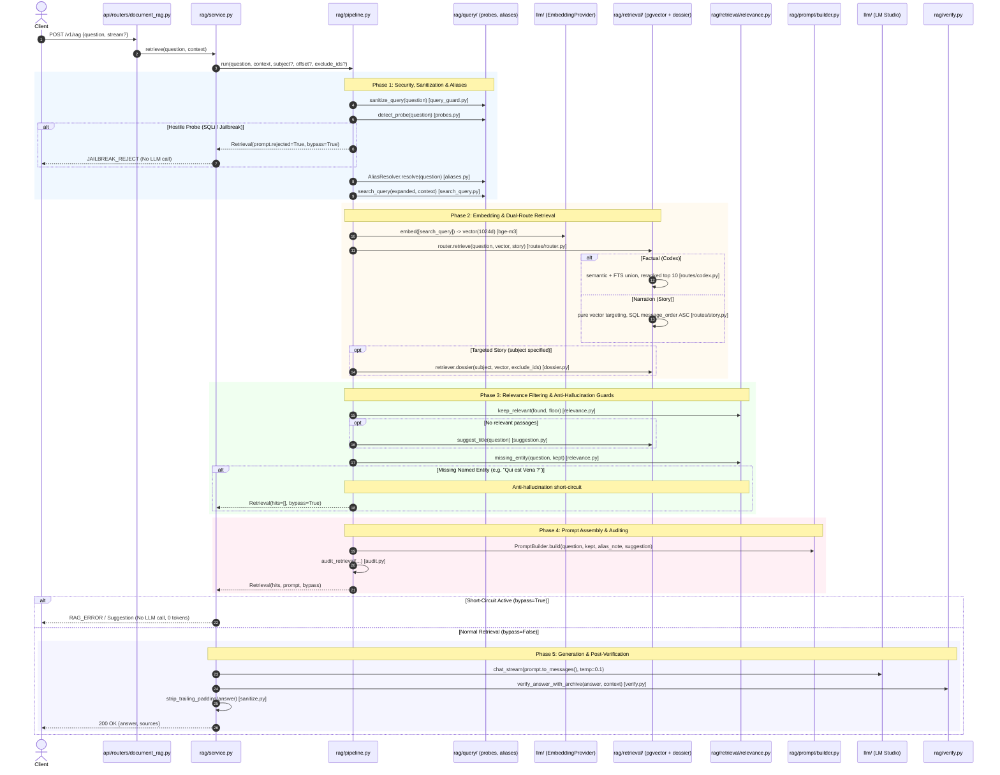

# RAG Architecture & Execution Flow — Cephalon Archive

> **Cognitive Map & Execution Trace**: This document maps the exact end-to-end
> execution pipeline of the RAG subsystem. Use it to trace requests from client
> ingestion to response verification without having to read across all 15 micro-modules.

---

## 1. End-to-End Sequence Diagram

---

## 2. The 5 Pipeline Phases

| Phase | Responsibility | Key Module / Function | Invariant / Business Rule |
|---|---|---|---|
| **1. Query Sanitization & Expansion** | Normalizes user input, screens out attacks and expands nicknames. | `query/query_guard.py` `query/probes.py` `query/aliases.py` `query/search_query.py` | • Strips non-printable ASCII/control chars. • Hostile probes (SQLi, roleplay overrides) are flagged immediately. • `AliasResolver` maps colloquial names (*"Mercenaire d'Os"*) to canonical names (*"Ordan Karris Ordis"*) **before** embedding. • Resolves anaphoric references using session `RAGContext`. |
| **2. Embedding & Dual-Route Retrieval** | Converts text to dense vectors and dispatches to the Codex or Story strategy. | `llm/lmstudio.py` `retrieval/routes/` `retrieval/hybrid.py` `retrieval/dossier.py` | • 1024-dimensional embeddings via local `bge-m3`. • **Codex**: semantic (`MergedRetriever`) + full-text (`HybridSearch.lexical_hits`) union, reranked to the 10 most relevant passages. • **Story**: pure vector targeting, NO lexical channel and NO reranker; SQL imposes `message_order ASC NULLS LAST` and excludes `game_updates` / `game_announcements` / `patch_notes`. • Cosine distance (`<=>`) backed by HNSW index (`ef_search = 200`). • In story mode (`subject`), queries biographical pages first (`dossier.py`, order preserved). |
| **3. Relevance & Anti-Hallucination** | Filters noise and prevents hallucinations on absent entities. | `retrieval/relevance.py` `retrieval/suggestion.py` | • **Relevance floor**: passages with cosine score < `0.50` are dropped. • **Entity guard**: for *"Qui est X ?"*, if "X" is absent from all retained chunks, short-circuit immediately. • If weak match: suggests close canon title (*"Voulez-vous dire « Y » ?"*). |
| **4. Strict Prompt Assembly** | Delimits context inside XML tags with amnesia directives. | `prompt/builder.py` `prompt/guards.py` `audit.py` | • Single system message with `<archives>{context}</archives>`. • Real-world amnesia directive (prevents leaking pre-trained world knowledge). • Context capped at `max_context_chars` (default ~4500-6000 chars / ~1500 tokens). • Audit line logged via `audit_retrieval()`. |
| **5. Inference & Verification** | Generates response and verifies groundedness. | `service.py` `verify.py` `sanitize.py` | • **Low temperature (`0.1`)** for deterministic factual generation. • Post-generation check (`verify_answer_with_archive`): checks if key entities in the answer exist in the context. • Strips trailing padding/formatting noise. |

---

## 3. The 3 Short-Circuit Mechanisms (Zero-LLM Abstention)

The model is intentionally **never called** when any of the following conditions occur:

1. **Hostile Probe (`rejected=True`)**:
   - Query matches SQL injection signatures, prompt injection attempts, or roleplay hijack patterns (`detect_probe`).
   - Served immediately with `JAILBREAK_REJECT`. Costs zero GPU compute and doesn't pollute session memory.
2. **Relevance Floor Drop (`hits == [] and suggestion is None`)**:
   - Out-of-corpus topics, random chatter, or typos with similarity below the critical floor (calibrated at `0.50`).
   - Served with standard mnemonic `RAG_ERROR` (*"Données insuffisantes ou inexistantes dans les archives..."*).
3. **Missing Named Entity (`missing_entity != None`)**:
   - Query asks for a specific subject (*"Qui est Vena ?"*), but the retrieved chunks do not contain that name.
   - Prevents the LLM from hallucinating a plausible fiction when the corpus is silent.

---

## 4. Narrative Mode (Pagination & Continuation)

Targeted stories (*"Raconte-moi l'histoire de Lettie"*) use a dedicated continuation protocol:
- **Route selection**: `RetrievalRouter` sends narration wording (or the explicit `story` flag) to `StoryRoute`; factual lookups go to `CodexRoute`.
- **Chronology**: `StoryRoute` only picks the semantic neighbourhood — the final order is SQL's (`coalesce(kim_dialogue.message_order, game_dialogue.message_order) ASC NULLS LAST`, then page and chunk id), never the vector's.
- **`subject`**: Reads the subject's own wiki page chunks in narrative order first (tier SQL).
- **`exclude_ids`**: The **only** cursor mechanism. Chunks already shown are recorded and excluded in subsequent turns (`NOT (lore_chunks.id = ANY(:exclude_ids))`).
- **`offset > 0`**: Continuation turns omit semantic neighbours to prevent re-anchoring on the same introductory facts.

